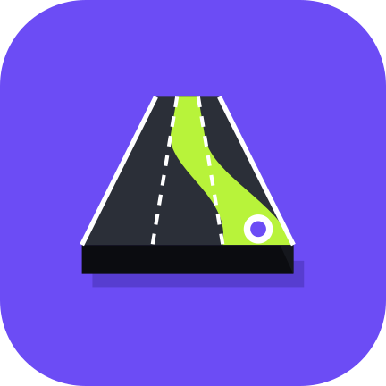

# LaneWise

**3D lane-level navigation for Germany (focus: Region Hannover) — with lane assist that avoids
unnecessary lane changes.**

<p align="center"></p>

LaneWise is an Android driving app inspired by the 3D lane guidance of Petal Maps and AMAP, built
on fresh open German data instead of their outdated lane data.

## Features
- **Advanced lane assist** — plans your lane across the next junctions (up to 4 km) so you change
  lanes as rarely as possible. Toggle: *Einstellungen → Spurassistent → Spurwechsel so weit wie möglich vermeiden*.
  Optional keep-right rule for the Autobahn (§ 7 StVO). Tap a lane in the lane bar to tell the app which lane you're in.
- **3D lane view** — tilted 3D map with 3D buildings, the route's road drawn lane by lane (pre-built per
  kilometre, so it never jitters), a lime strip in your recommended lane over a soft band of all usable lanes,
  and a raised arrow through each turn. Lanes that open (turn pockets, widening roads) are entered without a
  "lane change"; at a turn only the turn lanes continue through the junction.
- **Two view styles** — *Lane map (AMAP style)*: no junction box, the camera closes in at turns and lane changes
  and pulls back on open road; or the classic view with a perspective junction close-up. Optionally show all
  streets while driving (*Petal style*) with only the route highlighted.
- **Junction details** — traffic-light pop-up at the next signalised junction (signals, inferred arrow lights,
  Grünpfeil, pedestrian lights, push button), solid-line warning before lane changes stop being allowed
  (OSM `change:lanes`), countdown bars on the manoeuvre banner and the lane-change hint.
- **Speed limits** — German round sign (incl. de-restricted Autobahn), **light-red screen border**
  when too fast (pulsing) or too slow; both offsets adjustable in Settings.
- **Official traffic data** — Die Autobahn GmbH (roadworks/closures), TomTom, HERE, Mobilithek (VMZ Niedersachsen).
- **Offline / satellite-only** — download Region Hannover once; afterwards map, routing, lanes and
  speed limits work with GNSS only (GPS/Galileo/GLONASS/BeiDou), no internet; offline routes respect OSM turn restrictions.
- **Voice** — English (default), German, Vietnamese; Android TTS or natural OmniVoice voice packs rendered on a
  PC (`tools/voice_pack/`).
- **Lanes from aerial photos** (work in progress) — the official 20 cm LGLN photos and an ML model fill gaps in
  OSM lane data (`tools/aerial_lanes/`).
- **Report wrong lanes** — long-press the lane bar while driving; reports are saved as GeoJSON
  (`lane_reports.geojson`) for fixing OpenStreetMap in JOSM / iD.
- Guidance keeps running with the screen off (ongoing notification).
- Light/dark mode, favourites, bike lanes, road signs, demo drive for testing at your desk (− / + on the DEMO badge: ×0.25 … ×8).

## Install
Every push builds APKs in GitHub Actions → *Actions → Build → Artifacts → LaneWise-apks*.
Tag `v0.1.0` to publish a release with the APKs attached. Install the APK on Android 8.0+
(allow "install unknown apps").

## Build locally
Requirements: JDK 17–21 (**not** Java 25 — Android Studio's bundled JBR is too new for Gradle 8.14),
Android SDK with platform 36 (`local.properties` → `sdk.dir`, not committed).

Windows, one command (tests + debug APK → `app/build/outputs/apk/debug/LaneWise-v<version>-debug.apk`):
```powershell
.\build-local.ps1
```
Add `-Release` for the minified release APK, `-Install` to install on a USB-connected phone.
The script uses its own Gradle home (`%LOCALAPPDATA%\LaneWise\gradle-home`).

Other platforms:
```bash
./gradlew testDebugUnitTest assembleDebug
```
Optional API keys in `local.properties` (never committed):
```
TOMTOM_API_KEY=...
HERE_API_KEY=...
```
Map styles are generated: `python tools/gen_map_styles.py`.

Opt-in check of the owner's real test route (needs internet; prints rendering and lane-advice problems):
```bash
LANEWISE_LIVE=1 ./gradlew testDebugUnitTest --tests '*RouteRenderLiveTest*'
```
`LANEWISE_ALT=0` / `1` picks the route option, `LANEWISE_TRACE=1` prints the lane bar / hint every 20 m along the route.

OSM vs TomTom lane data on the same route (needs `TOMTOM_API_KEY` in `local.properties`; writes
`app/build/reports/lanewise/provider_compare.html`):
```bash
LANEWISE_LIVE=1 ./gradlew testDebugUnitTest --tests '*ProviderCompareLiveTest*'
```
After changing a spoken phrase, refresh the voice-pack script list: `./gradlew testDebugUnitTest -PupdateVoiceInventory`.

## Docs
| File | What |
| --- | --- |
| [docs/LANE_ALGORITHM.md](docs/LANE_ALGORITHM.md) | how lane choice works |
| [docs/ARCHITECTURE.md](docs/ARCHITECTURE.md) | code layout, data flow, offline mode, CI |
| [docs/DATA_SOURCES.md](docs/DATA_SOURCES.md) | APIs, keys, attribution |
| [docs/REVERSE_ENGINEERING.md](docs/REVERSE_ENGINEERING.md) | what was learned from Petal Maps & AMAP |
| [docs/ROADMAP.md](docs/ROADMAP.md) | status and next steps |
| [tools/aerial_lanes/README.md](tools/aerial_lanes/README.md) | lane counts from aerial photos (ML pipeline) |
| [tools/voice_pack/README.md](tools/voice_pack/README.md) | OmniVoice voice packs |
| [CLAUDE.md](CLAUDE.md) | hand-off notes for AI-assisted sessions |

## Attribution
© OpenStreetMap contributors (ODbL) · tiles OpenFreeMap · routing FOSSGIS OSRM · traffic
Die Autobahn GmbH des Bundes, TomTom, HERE, Mobilithek · aerial photos © LGLN 2025/2026 (CC BY 4.0) ·
voices rendered with OmniVoice (k2-fsa, Apache-2.0). LaneWise contains no code, images or
data from Petal Maps or AMAP.
